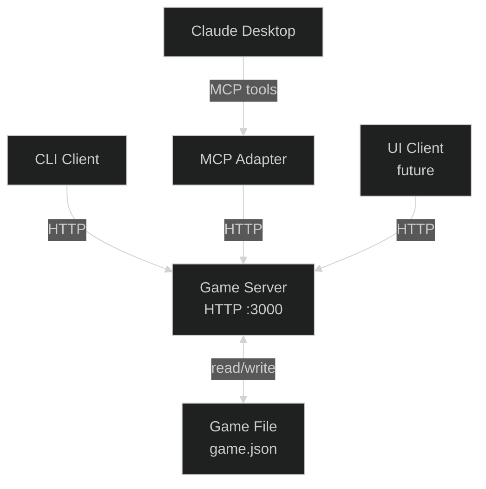
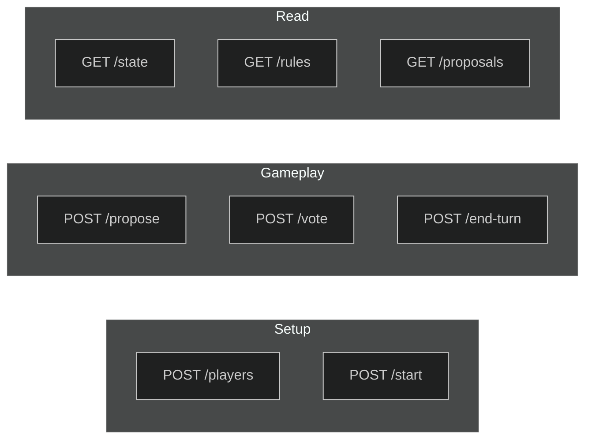
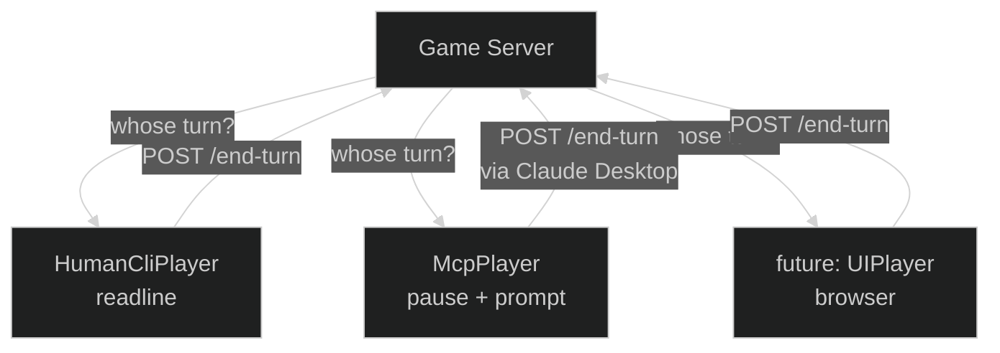
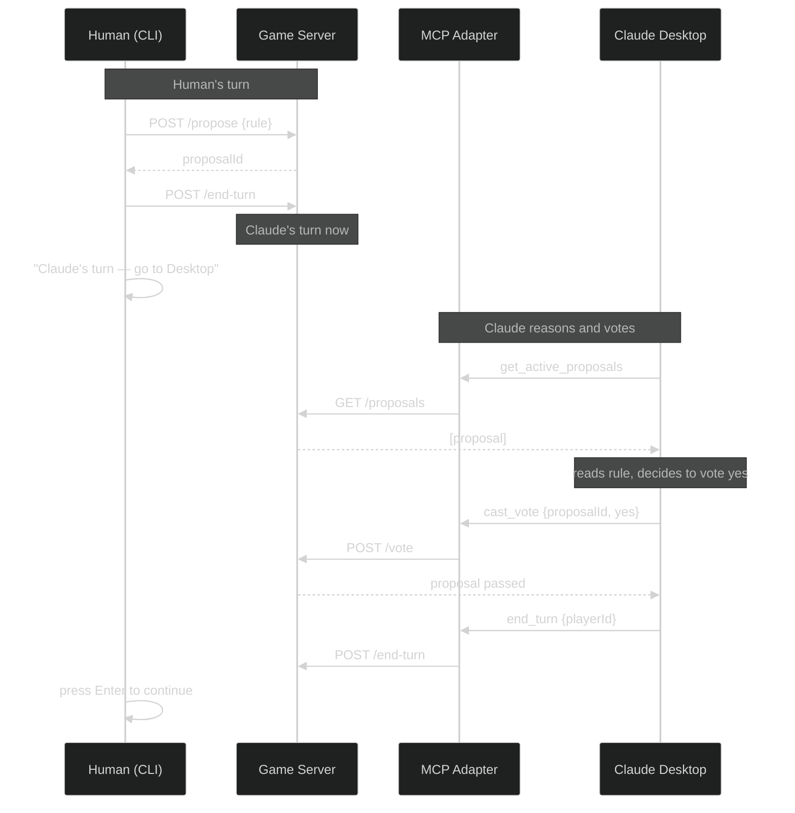
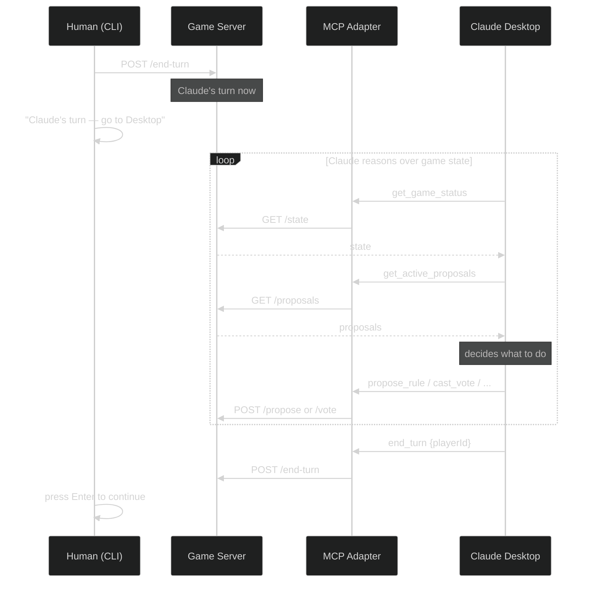
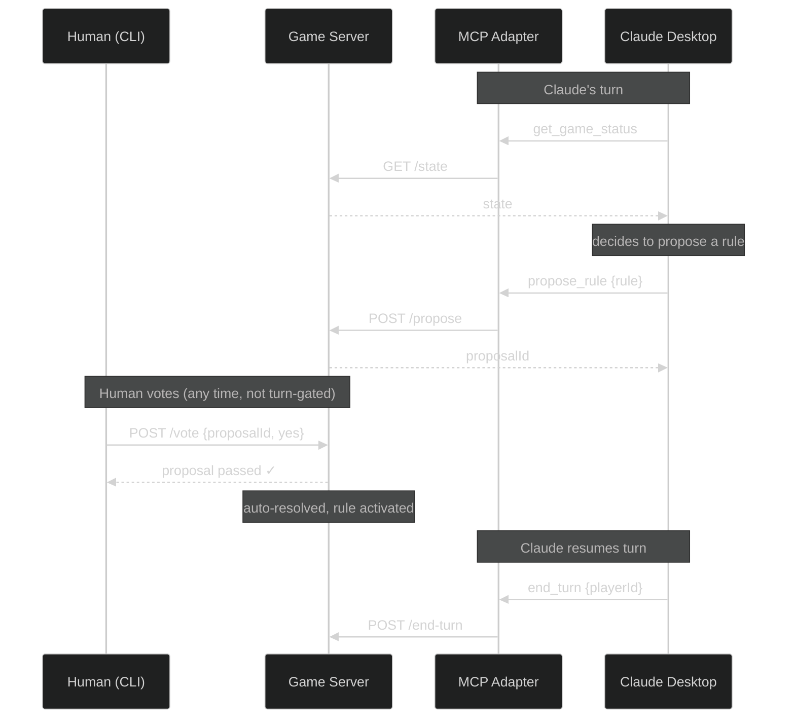
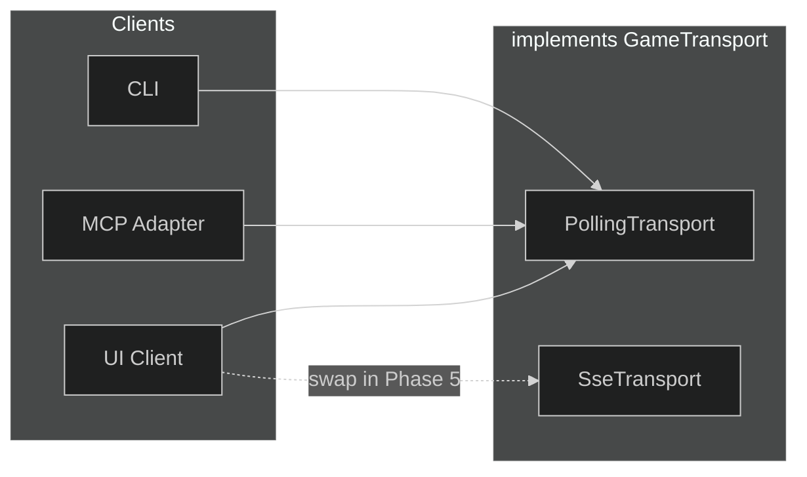

# Nomic Engine — Roadmap

A living document capturing the architectural direction and planned milestones.

---

## Vision

The engine is a pure state machine. Everything else — CLI, AI players, web UI — are clients talking to a central game server over HTTP. The server is the single authority on game state and turn order.



---

## Architecture Principles

- **Server is the authority** — enforces turn order, validates all actions, rejects out-of-turn requests with 4xx
- **Clients are dumb** — display state, submit actions, no game logic
- **File is the source of truth** — game state persists to JSON after every action; server loads from file on startup
- **Player identity** — clients pass `playerId` in request body (trust-based, appropriate for local play)

---

## HTTP API



All write endpoints validate that the requesting `playerId` is the current player (or eligible voter). Returns `409` if out of turn.

---

## Player Types

The server stores `isAI: boolean` on each player record. Clients decide how to handle their turn — the server doesn't care.



---

## MCP Integration

The MCP adapter is a thin layer — it wraps HTTP calls as MCP tools so Claude Desktop can participate as a player using a Claude subscription (no API costs).

### AI votes on a human proposal





### AI proposes, human votes

Voting is not turn-gated — any player can vote at any time. The proposer's turn continues after proposing; they end it only after all votes are in and the proposal resolves.



---

## Roadmap

### Phase 1 — HTTP Game Server
Extract the game loop from the CLI into a standalone HTTP server.

- `nomic server <game-file> [--port 3000]`
- All REST endpoints with turn validation
- Voting is asynchronous — `POST /vote` accepts votes from any player at any time; server auto-resolves once all votes are in
- Game file persisted after every action
- Existing `NomicEngine` and state machine unchanged

### Phase 2 — CLI Client
Refactor CLI to be a thin client against the HTTP server.

- `nomic play <server-url> --player-id <id>`
- Polls `/state` to detect whose turn it is
- Submits actions via HTTP
- `HumanCliPlayer` handles interactive readline loop

### Phase 3 — MCP Adapter + Claude Desktop
Thin MCP server that wraps the HTTP API as tools.

- `nomic mcp <server-url>`
- Tools: `get_game_status`, `get_rules`, `get_active_proposals`, `propose_rule`, `cast_vote`, `end_turn`
- Claude Desktop config points at the MCP adapter
- `McpPlayer` in CLI pauses and prompts human to switch to Claude Desktop

### Phase 4 — `nomic new` with AI Players
Game creation sets `isAI: true` on designated players.

- `nomic new <name> --players Andy --ai-players Claude`
- Stored in game file; clients use it to know how to handle turns

### Phase 5 — Server UI
Browser-based admin interface for creating and managing games, served directly by the game server.

- Create games, add players, configure AI players
- Lobby view showing all active games
- No gameplay — configuration only

### Phase 6 — UI Client
Browser-based gameplay client using `PollingTransport`.

- Full gameplay: propose, vote, end-turn
- Visual rule editor
- Spectator mode

### Phase 7 — Multi-game Server
Upgrade the server from single-file to managing multiple concurrent games.

- `nomic server <games-dir> [--port 3000]`
- Endpoints namespaced by game ID: `/games/:id/state`, `/games/:id/propose`, etc.
- `GET /games` lists all games and their status
- Each game still persists to its own JSON file

### Phase 8 — SSE in UI Client
Swap `PollingTransport` for `SseTransport` in the UI client.

- Server adds `GET /games/:id/events` endpoint
- UI client constructor changes from `PollingTransport` to `SseTransport`
- Board updates instantly without manual refresh
- CLI and MCP remain on `PollingTransport` unchanged

---

## Network Adapter

Each client communicates with the server through a `GameTransport` interface. This decouples client logic from the notification mechanism, making it trivial to swap polling for SSE per client independently.



The interface has two concerns — actions (always HTTP POST) and state updates (polling or push):

```ts
interface GameTransport {
  // actions — always HTTP, same for all transports
  propose(playerId: string, rule: Rule): Promise<void>;
  vote(playerId: string, proposalId: string, value: VoteValue): Promise<void>;
  endTurn(playerId: string): Promise<void>;

  // state — polling or push depending on transport
  getState(): Promise<GameState>;
  onStateChange(callback: (state: GameState) => void): Unsubscribe;
}
```

`PollingTransport` implements `onStateChange` by calling `getState()` on an interval. `SseTransport` implements it by opening a `GET /events` connection. The client never knows the difference.

- **CLI and MCP**: use `PollingTransport` permanently — no readline/SSE friction
- **Browser UI**: starts on `PollingTransport`, swaps to `SseTransport` in Phase 5 by changing one constructor call

---

## Open Questions

- **SSE vs polling** — decided: polling for CLI and MCP (permanent), SSE for browser UI (Phase 5 upgrade via `SseTransport` swap).
- **Multi-game server** — single server instance per game file, or one server managing multiple games?
- **Auth** — `playerId` in body is fine for local play; revisit if games go over a network.
