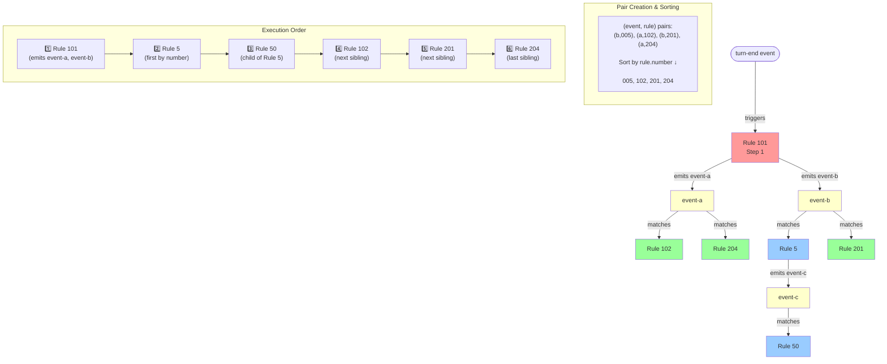
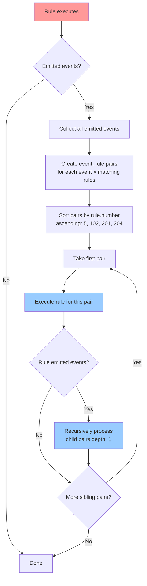
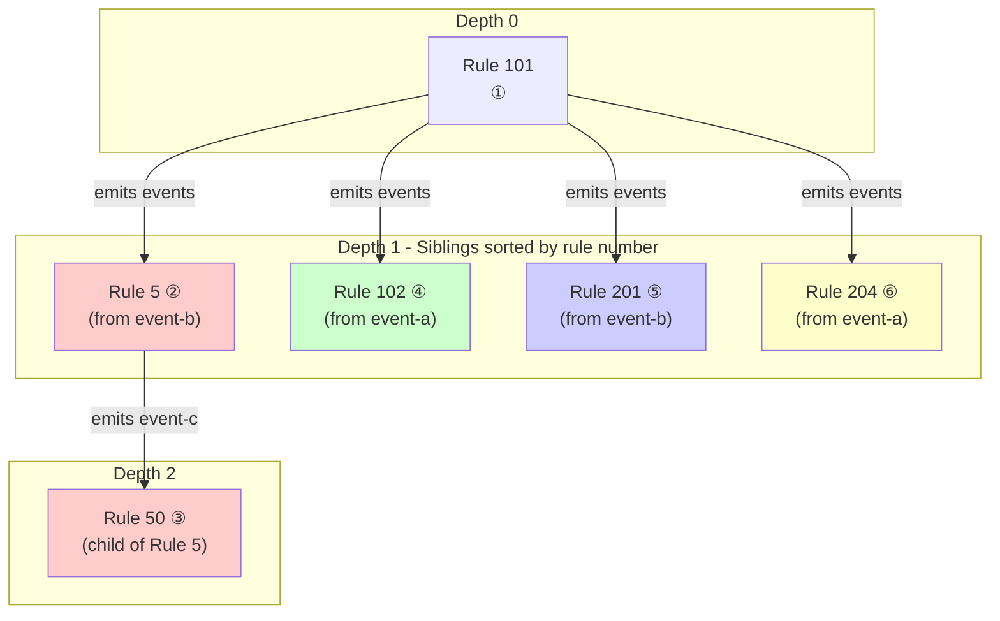

# Rule Event Execution - Depth-First Preorder Traversal

This document explains how the Nomic engine processes events and executes rules using depth-first preorder traversal with rule-number sorting.

## Overview

When rules emit events, the engine creates (event, rule) pairs for all matching rules, sorts them by rule number, and executes each pair's entire descendant tree before moving to the next sibling. This ensures cascading rule effects complete before sibling rules execute.

## Example Scenario

```
turn-end event → Rule 101 emits [event-a, event-b]
  event-a matches → Rules 102, 204
  event-b matches → Rules 005, 201
  Rule 005 emits → event-c
    event-c matches → Rule 050
```

**Execution Order:** 101 → 5 → 50 → 102 → 201 → 204

---

## Event Flow Diagram

This diagram shows how events flow through the system and trigger rules:



---

## Algorithm Flowchart

This diagram shows the step-by-step algorithm for processing events:



---

## Tree Structure with Depth Levels

This diagram shows the tree structure and how depth is tracked per-branch:



**Key Insights:**

- **Red (Rules 5 & 50)**: Rule 5's entire descendant tree (including Rule 50) executes completely before moving to siblings
- **Green (Rule 102)**: Next sibling by rule number
- **Blue (Rule 201)**: Next sibling
- **Yellow (Rule 204)**: Final sibling

---

## Why Depth-First Instead of Breadth-First?

### Breadth-First (Old Approach)
Execution order: **101 → 5 → 102 → 201 → 204 → 50**

All siblings at depth 1 execute before any children at depth 2.

### Depth-First Preorder (New Approach)
Execution order: **101 → 5 → 50 → 102 → 201 → 204**

Each sibling's entire descendant tree executes before moving to the next sibling.

### Why This Matters for Nomic

The depth-first approach aligns with Nomic's philosophy where:

1. **Cascading effects complete first**: When Rule 5 executes and emits event-c, Rule 50's effect should complete before other rules at the same level execute
2. **Legal precedent model**: Like real law, earlier provisions (lower-numbered rules) are fully interpreted with all their consequences before later provisions
3. **Predictability**: Players can reason about "If my rule fires, what's the complete cascade?" rather than "what gets interleaved?"
4. **Rule ordering matters**: Lower-numbered rules (often immutable base rules) fully execute with all side effects before higher-numbered player rules

---

## Execution Limits

- **Per-branch depth limit**: 100 levels
  - Each sibling branch can go 100 levels deep independently
  - Prevents infinite recursion in a single chain

- **Global node limit**: 1000 total rule executions
  - Prevents runaway execution across the entire tree
  - Counts all rules executed across all branches

When either limit is exceeded, the dispatcher logs a warning and stops processing.

---

## Implementation Details

### Key Data Structures

```typescript
interface DispatchResult {
  state: GameState;
  totalNodes: number;
}

interface EventRulePair {
  event: GameEvent;
  rule: Rule;
}
```

### Core Methods

1. **processEvents(state)**: Main entry point
2. **processEventsWithTracking(state, totalNodes)**: Internal tracking method
3. **dispatchEvent(state, event, depth, totalNodes)**: Processes a single event
4. **dispatchEventForRule(state, event, rule, depth, totalNodes)**: Processes a specific (event, rule) pair

### Pair Creation and Sorting

**For all events** (both initial events in `pendingEvents` and events emitted by rules):
1. Collect all events
2. For each event, find all matching rules
3. Create (event, rule) pairs
4. Sort pairs by `rule.number` in ascending order (5, 102, 201, 204)
5. Execute each pair depth-first

This ensures that **regardless of the order events are emitted or appear in pendingEvents**, the execution order is deterministic and based on rule numbers.

**Example:**
If `pendingEvents = [event-a, event-b]` where:
- event-a triggers Rule 102
- event-b triggers Rule 5

Execution order will be: **Rule 5, then Rule 102** (sorted by rule number, not event order)
