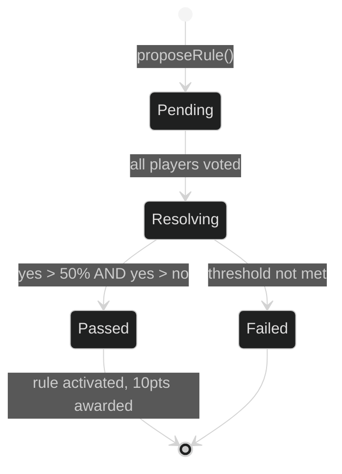
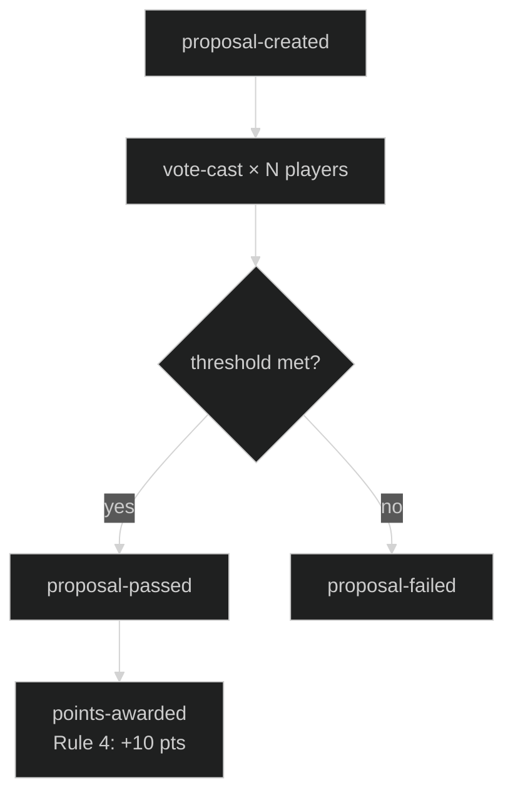

# Voting System

How proposals are created, voted on, and resolved in the Nomic engine.

---

## Lifecycle Overview

---

## Step 1 — Proposal Creation

Any active player can call `proposeRule()` during their turn. The engine enforces **Rule 2: one proposal per turn** — it checks that the player has not already created a proposal since `turnStartedAt`.

A proposal is created with:
- A unique `id`
- `type`: `add-rule`, `modify-rule`, or `remove-rule`
- `proposedBy`: the proposing player's ID
- `votes`: an empty Map
- `status`: `'pending'`

The `proposal-created` system event is emitted immediately. **The proposer's turn does not end** — they continue their turn after proposing.

---

## Step 2 — Voting

All active players vote once per proposal. There is **no turn restriction on voting** — any player can vote at any time regardless of whose turn it is.

Vote values: `yes`, `no`, `abstain`.

The engine prevents:
- Voting on a resolved proposal
- A player voting twice on the same proposal
- Inactive players voting

Each vote emits a `vote-cast` system event.

---

## Step 3 — Auto-Resolution

Resolution is **automatic**: as soon as all active players have voted, the engine calls `resolveProposal()` immediately inside `vote()`.

**Passing threshold** (Rule 3 — Majority Vote):
- Yes votes must exceed 50% of active players
- Yes votes must outnumber no votes

**If passed:**
- Rule is activated (`isActive: true`) and applied to game state
- Proposal moves to `proposalHistory`
- `proposal-passed` event emitted → triggers Rule 4 (proposer receives 10 points)

**If failed:**
- Proposal moves to `proposalHistory` with `status: 'failed'`
- No rule changes

---

## Current CLI Behaviour

The CLI conducts voting **inline and synchronously** immediately after a proposal is created. All players vote in sequence right then, before any other commands are accepted. The proposer then ends their turn manually after voting completes.

This is a simplification of the current single-process CLI — in the HTTP server architecture, voting will be asynchronous: any client can submit a vote at any time, and the server resolves automatically once all votes are in.

---

## Event Chain

Events are processed via the `EventDispatcher` using depth-first preorder traversal, sorted by rule number.

---

## Initial Rules

| Rule | Description | Mutable |
|------|-------------|---------|
| Rule 2 | One proposal per turn | No |
| Rule 3 | Majority vote (>50%, yes > no) | No |
| Rule 4 | Proposer earns 10 pts when rule passes | No |

---

## Key Facts for Client Implementors

- **Proposer's turn continues** after proposing — they end their turn separately
- **Voting is not turn-gated** — any player can vote at any time via `POST /vote`
- **Resolution is automatic** — no client needs to trigger it
- **All players must vote** before resolution (default: `requireAllVotes: true`)
- A player who has not yet voted will block resolution
